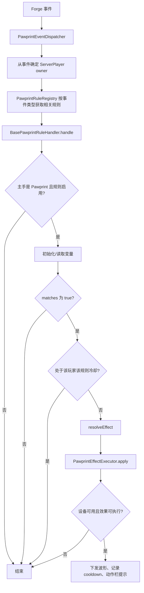

# Pawprint 规则系统说明

本文记录 `dg_toy` 当前的 Pawprint（爪印）规则实现，供后续添加、维护和排查规则时参考。

> 当前阶段约束：规则配置保存在**玩家主手的 PawprintItem** NBT 中。后续若改为背包、Curios 或能力系统，需要先调整 `PawprintRuleNbtHelper#getOwnerPawprintStack` 的配置来源。

## 1. 系统目标与组成

规则系统采用 Java 驱动：每条规则是一个继承 `BasePawprintRuleHandler<TEvent>` 的类，而不是 JSON。

核心组件：

| 类 | 职责 |
| --- | --- |
| `BasePawprintRuleHandler<TEvent>` | 规则模板：检查 Pawprint、启用状态、变量初始化、匹配、冷却、效果施加、异常提示。 |
| `PawprintRuleRegistry` | 按 Forge 事件类型索引规则，避免无关规则接收事件。 |
| `PawprintRules` | 统一注册入口。新增规则后必须在此注册。 |
| `PawprintEventDispatcher` | Forge 事件桥接器，负责从事件中确定规则拥有者并分发。 |
| `PawprintRuleContext<TEvent>` | 向规则传递拥有者、Pawprint `ItemStack` 与原始事件。 |
| `PawprintRuleVariable<T>` | 规则变量元数据：key、显示名、类型、默认值、校验器。 |
| `PawprintRuleNbtHelper` | 统一读写 Pawprint NBT 中的规则启用状态与变量。 |
| `PawprintRuntimeState` | 内存态运行时数据，当前用于按“玩家 + 规则”记录最后成功触发 tick。 |
| `PawprintEffect` | 规则命中后要执行的波形效果。 |
| `PawprintEffectExecutor` | 检查设备条件后，通过 dglib 调用设备控制接口。 |

## 2. 规则数据结构

### 2.1 规则处理器

每条规则至少实现以下方法：

- `getDisplayName()`：显示在 Pawprint UI 和触发提示中的名字。
- `getRuleId()`：稳定、唯一的英文 ID。**一经发布不要随意修改**，因为它也是 NBT 键名。
- `getEventType()`：规则订阅的 Forge 事件类型。
- `matches(context)`：实际判定逻辑，返回 `true` 才允许触发。
- `resolveEffect(context)`：返回效果；返回 `null` 表示本次不执行效果。

规则注册时还必须指定一个 `PawprintMode`。Pawprint UI 只显示当前爪印模式下注册的规则。

可选覆写：

- `getVariables()`：声明玩家可配置变量。
- `getCooldownTicks(context)`：设置本规则的成功触发冷却 tick；`20 tick = 1 秒`。
- `afterTriggered(context)`：效果已成功下发后的附加行为。

### 2.2 变量定义

变量使用 `PawprintRuleVariable<T>` 描述：

```java
private static final PawprintRuleVariable<String> KEYWORD =
        new PawprintRuleVariable<>("keyword", "关键词", String.class, "aaa", value -> !value.isBlank());
```

字段含义：

| 字段 | 用途 |
| --- | --- |
| `key` | NBT 中使用的稳定变量键。 |
| `displayName` | 设置页显示给玩家的名称。 |
| `type` | 变量 Java 类型。 |
| `defaultValue` | 缺失或校验失败时写回的默认值。 |
| `validator` | 服务端校验逻辑，不应仅依赖客户端输入限制。 |

### 2.3 当前变量类型限制

当前 NBT 帮助器、C2S 同步包和设置页只完整实现了 `String` 变量。

数值变量可以像“六变量求和”规则一样，以**字符串保存 + 整数校验**的方式实现。这样能在当前 UI 中编辑，但规则内必须自行 `Integer.parseInt`。

若后续需要原生 `Integer`、`Boolean`、枚举或波形选择器，应同步扩展：

1. `PawprintRuleNbtHelper` 的类型读写方法；
2. C2S 配置同步包；
3. `PawprintRuleSettingsScreen` 的控件渲染与保存；
4. `BasePawprintRuleHandler#initializeDefaults` 的默认值初始化。

## 3. Pawprint NBT 结构

规则数据保存在 Pawprint `ItemStack` 的根 NBT 中：

```text
PawprintRules: {
  <ruleId>: {
    enabled: true,
    vars: {
      <variableKey>: <value>
    }
  }
}
```

例：

```text
PawprintRules: {
  chat_contains_keyword: {
    enabled: true,
    vars: { keyword: "aaa" }
  },
  chat_number_equals_variables_sum: {
    enabled: true,
    vars: {
      variable_1: "1",
      variable_2: "2",
      variable_3: "3",
      variable_4: "4",
      variable_5: "5",
      variable_6: "6"
    }
  }
}
```

规则标签首次访问时自动创建，`enabled` 默认为 `true`；变量首次读取时会按变量定义写入默认值。

## 4. 执行逻辑

### 4.1 事件分发



### 4.2 通用前置条件

对所有当前规则，以下条件会阻止效果执行：

1. 玩家主手不是 `PawprintItem`。
2. 对应规则在 Pawprint UI 中没有启用。
3. `matches` 返回 `false`。
4. 规则处于自身冷却期。
5. 效果没有有效 `pulseId`。
6. 玩家没有通过 Curios 佩戴 `PowerboxItem`。`PawprintEffectExecutor` 会调用 `RemoteControlStateHelper.isShockAvailable`，当前该方法要求已佩戴 Powerbox。

规则成功下发后，玩家动作栏会显示：`爪印规则触发: <规则显示名>`。

规则执行期间发生异常时，基础处理器会捕获异常，并在动作栏显示 `爪印规则执行失败: <ruleId>`。

### 4.3 冷却语义

冷却状态位于内存中的 `PawprintRuntimeState`，键为：

```text
玩家 UUID + ruleId -> 上次成功触发的游戏 tick
```

只有 `PawprintEffectExecutor.apply(...)` 返回成功后才会记录冷却。因此设备条件不满足时不会消耗冷却。

运行时冷却不保存到 NBT；重启服务器后会丢失，这是预期行为。

## 5. 效果数据

`PawprintEffect` 的字段：

```java
new PawprintEffect(channel, strength, hardMode, pulseId, duration)
```

| 字段 | 含义 |
| --- | --- |
| `channel` | 设备通道。 |
| `strength` | 强度。 |
| `hardMode` | `true` 调用 `control`，`false` 调用 `controlSoft`。 |
| `pulseId` | dglib 中已注册的波形 ID。必须是实际可用的 ID，例如当前示例使用过 `chaos`、`const`。 |
| `duration` | 持续时间，单位秒。 |

不要随意写一个未注册的波形 ID；例如过去的 `wave1` 在工程中没有注册来源，不能作为可靠示例。

## 6. 现有规则

| 规则 ID | 显示名 | 事件 | 条件 | 效果 |
| --- | --- | --- | --- | --- |
| `chat_contains_keyword` | 聊天包含关键词 | `ServerChatEvent` | 聊天内容包含 `keyword`。 | channel 1、强度 40、软模式、`chaos`、5 秒。 |
| `chat_number_equals_variables_sum` | 聊天数字等于变量之和 | `ServerChatEvent` | 聊天文本是整数，且等于变量1至变量6之和。 | channel 1、强度 40、软模式、`chaos`、1 秒。 |
| `player_crouch` | 玩家下蹲 | `PlayerTickEvent` | 保持下蹲。 | channel 3、强度 40、软模式、`const`、1 秒；冷却当前为 25 tick。 |

注意：`player_crouch` 当前是持续检测规则，只要保持下蹲，经过冷却后会再次施加效果；它不是边沿检测规则。

## 7. Pawprint UI 与同步

Pawprint UI 会从 `PawprintRuleRegistry` 读取已注册规则：

- 左键点击规则开关：切换 `enabled`，通过 C2S 包写回服务端主手 Pawprint NBT。
- 右键点击规则开关：打开该规则的设置页。
- 设置页会显示全部 `String` 变量，点击保存后逐个通过 C2S 包同步。

相关网络包：

| 包 | 用途 |
| --- | --- |
| `DgToyC2SPawprintRuleTogglePacket` | 修改某个规则的启用状态。 |
| `DgToyC2SPawprintRuleStringVarPacket` | 修改某个字符串变量。服务端会根据规则元数据校验键、类型和值。 |

服务器只接受主手持有 Pawprint 时发来的更新，这与规则执行时的配置来源保持一致。

## 8. 新增规则步骤

### 8.1 创建规则类

在 `org.nooberic.dg_toy.pawprint.rule` 新建类，继承正确事件类型的处理器：

```java
public final class ExampleRule extends BasePawprintRuleHandler<ServerChatEvent> {
    private static final String RULE_ID = "example_rule";

    @Override
    public String getDisplayName() {
        return "示例规则";
    }

    @Override
    public String getRuleId() {
        return RULE_ID;
    }

    @Override
    public Class<ServerChatEvent> getEventType() {
        return ServerChatEvent.class;
    }

    @Override
    protected boolean matches(PawprintRuleContext<ServerChatEvent> context) {
        return true;
    }

    @Override
    protected PawprintEffect resolveEffect(PawprintRuleContext<ServerChatEvent> context) {
        return new PawprintEffect(1, 40, false, "chaos", 1);
    }
}
```

### 8.2 声明变量（需要玩家配置时）

声明变量并覆写 `getVariables()`：

```java
private static final PawprintRuleVariable<String> TEXT =
        new PawprintRuleVariable<>("text", "文本", String.class, "default", value -> !value.isBlank());

@Override
public List<PawprintRuleVariable<?>> getVariables() {
    return List.of(TEXT);
}
```

在 `matches` 或 `resolveEffect` 中使用：

```java
String text = PawprintRuleNbtHelper.getStringVariable(context.pawprintStack(), RULE_ID, TEXT);
```

任何从玩家 NBT 读出的变量都应使用对应帮助方法和校验器，不要直接信任 NBT 内容。

### 8.3 设置冷却（需要时）

```java
@Override
protected int getCooldownTicks(PawprintRuleContext<ServerChatEvent> context) {
    return 20;
}
```

### 8.4 注册规则

在 `PawprintRules.bootstrap()` 中导入并注册：

```java
  PawprintRuleRegistry.register(PawprintMode.MOTION, new ExampleRule());
```

不注册就不会被分发器获取，UI 里也不会显示。

### 8.5 接入事件分发（事件类型尚未支持时）

若事件类型已有分发，例如 `ServerChatEvent` 或 `TickEvent.PlayerTickEvent`，仅注册即可。

若是新的 Forge 事件类型，需要在 `PawprintEventDispatcher`：

1. 添加对应 `@SubscribeEvent` 方法；
2. 从事件中解析出规则拥有者 `ServerPlayer`；
3. 调用 `PawprintRuleRegistry.getHandlers(事件类型.class)`；
4. 对每个处理器调用 `handler.handle(owner, event)`。

对于高频事件（如 tick），应只在服务端适用阶段分发，并确保规则本身使用冷却或其他限制避免过度执行。

## 9. 测试清单

新增或修改规则后，至少检查：

1. 执行 `gradlew compileJava`。
2. 进入游戏后，主手拿 Pawprint，确认规则 UI 出现名称。
3. 确认规则开关状态可保存。
4. 右键开关，确认所有变量能显示、修改和保存。
5. 穿戴 Powerbox，再测试规则事件条件。
6. 使用真实已注册波形 ID。
7. 检查动作栏是否显示成功触发提示。
8. 对持续规则验证冷却节奏，不要只看第一次触发。

## 10. 后续改进建议

- 将规则变量扩展为原生数值、布尔、枚举、波形选择等类型。
- 将设置页改为滚动表单，以支持超过当前屏幕高度的变量列表。
- 为效果执行失败提供明确动作栏原因，例如“未佩戴 Powerbox”或“波形不存在”。
- 考虑将 Pawprint 配置来源从主手物品迁移到固定装备槽、能力系统或玩家数据。
- 可为规则增加本地化 key，替代当前硬编码显示文本。
